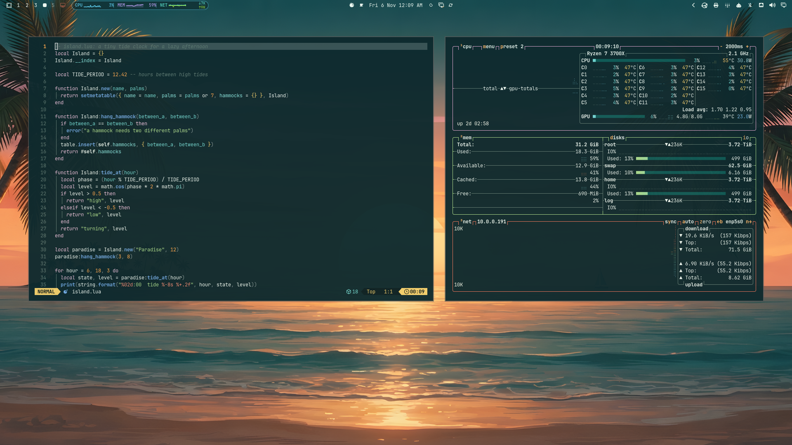
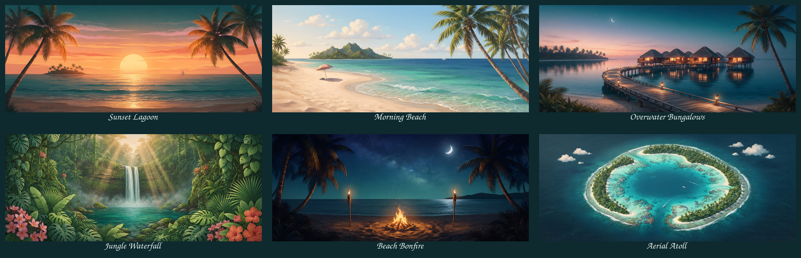

# Paradise

A warm, tropical theme for [Omarchy](https://omarchy.org): deep teal water, warm sand, coral and palm green. Bright and fun, but never a white flash.



## Install

```
omarchy theme install https://github.com/EmoStomper/omarchy-paradise-theme
```

Or open **Install → Style → Theme** from the Omarchy menu and paste the URL.

## Wallpapers

Six painted wallpapers at 3440×1440 (they crop nicely to 16:9 too). Pick one from **Style → Background** in the Omarchy menu.



Sunset Lagoon · Morning Beach · Overwater Bungalows · Jungle Waterfall · Beach Bonfire · Aerial Atoll

The wallpapers were generated with Google Gemini and upscaled with Real-ESRGAN.

## Palette

| Role | Hex |
| --- | --- |
| Background | `#0E2A2E` |
| Foreground | `#EAF6EF` |
| Accent | `#FFB86B` |
| Selection | `#0F5B56` |
| Red | `#E8735A` |
| Yellow | `#F2CE6B` |
| Orange | `#FFA94E` |
| Green | `#A8D98A` |
| Cyan | `#6FD6CF` |
| Blue | `#6FA8E0` |
| Magenta | `#E0A8D0` |

## License

[MIT](LICENSE)
